A page builder and CMS: Rails 8 stores, versions, caches and publishes the pages; a React and TypeScript editor builds them.

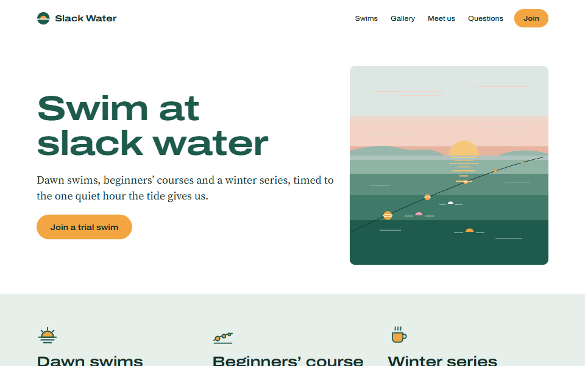

[Try the editor in your browser](https://builder.riccardosapuppo.com/) ·
[The API, described](cms/openapi.yaml) ·
[The page document's schema](schema/block-document.schema.json) ·
[Decisions, with their cost](docs/decisions/) ·
[The approved design](design/) ·
[The Rails application](cms/README.md) ·
[The editor](builder/README.md)

The editor builds a page from sections, columns and twenty kinds of
widget (heading, text, image, gallery, video, map, button, icon box, quote,
accordion, stats, steps, pricing, divider, spacer, form, logo, menu,
collection list and field),
dragged into place on the page or in the Outline, where the page moves
with the block as it goes; with rich text written where it stands on the
canvas, undo and redo, a tablet's and a phone's own values, a media
library and a form. It works on a tablet and on a phone too, with a
finger: the page first, its panels floating over it on a tablet and
rising from a bar at the foot on a phone.
It builds the site's header and footer the same way, from sections, columns and
blocks, parts of the site that every page shows once published, the header
staying at the top of the window if asked. Site style sets the site's
palette, colours of its own included, its type scale and its letter width,
over which a heading, a text or a quote may set its own size (in px, rem
or vw), weight, letter spacing, line height and letter width;
any block may take CSS classes and an anchor of its own, which the site's
custom CSS styles, inside the site and nowhere else. Rails keeps each page
as one JSON document that a single schema describes, with one draft and
its versions; publishes it now or at a set time; draws it on the server
and caches it; and keeps what visitors send from its form. The same editor
also runs with no server at all, keeping its pages in the browser: that is
the demo, [below](#the-two-modes).

Collections keep what a site repeats, news or events, typed. A
collection's fields are of nine types (text, paragraph, rich text,
number, date, image, link, toggle and choice); its entries are written in
the editor's Collections screen, each with a draft saved at a revision and
what is live. Its template, built on the canvas as a page is, with Field
blocks for the entry's values, draws every entry at `/<prefix>/<slug>`,
and a Collection list shows its published entries on any page, the page
at the collection's own prefix included: the example site's News is a
page at `/news` listing five entries, each at `/news/<slug>`. Rails
checks every value against its field with the editor's own rules,
written twice and held to one verdict, and caches each entry's page and
each list by what was published.

An Assistant writes with a model of the person's own, Anthropic's or
OpenAI's. The person brings the key. It is kept in the tab's memory only,
and the browser sends it to that provider and nowhere else. The Assistant
can do three things:

- **Write a page from a brief.** The page grows on the canvas section by
  section, and each section is a step in History.
- **Write a heading or a text again**: shorter, warmer, in another
  language.
- **Describe an image** of the library, from the picture itself.

What the model writes is read without trust, and held to the page's schema
like any edit. With no key, a sample written by hand goes through the same
steps. [The Assistant](builder/src/assistant/README.md) and
[where the key goes](docs/decisions/assistant-key-in-memory.md).

## Why Rails

Rails and React are the stack of the CMS work I want to do, and building
the thing is how I learn a stack, where listing it would only claim it.
The editor is the part that would stand on any back end. It speaks to the
server through an API that [`cms/openapi.yaml`](cms/openapi.yaml)
describes, not through Rails' code, and it can speak to the browser's own
storage instead.

Rails is the CMS here, not a store behind the editor. Everything a browser
cannot do alone is Rails' to do:

- it refuses a page that the schema or its rules refuse, and answers 422
  with the JSON pointer of each fault;
- it keeps one draft per page at a revision, answers 409 to a stale save,
  and keeps versions;
- it publishes, now or at a time set, by a job in Solid Queue;
- it draws the published page in ERB, with no script on it, and caches it:
  the whole page and each block, with an ETag and a 304;
- it keeps the media library in Active Storage;
- it takes what visitors send from a form, and the editor reads and deletes
  the answers.

All of it on Rails 8's own parts: SQLite, Solid Cache, Solid Queue. No Redis,
no Docker.

A personal project of the author's, not work for a client. The example site,
Slack Water, an invented swimming club, its text and its pictures, is made
for it.

## Before you start

There are three ways to use this repository, and they cost different
amounts.

**To run it**, with `npm start`, the machine needs:
- **Ruby 3.3 or later**, with Bundler, which ships with it. On Windows that
  is RubyInstaller with its DevKit, the MSYS2 toolchain that compiles the
  native parts of some gems: on the machine this was written on (Windows
  10, Ruby 3.4.11 installed for all users) RubyInstaller's folder took
  1174 MB on 2 October 2026, 1030 of them MSYS2.
- **Node 24.** An older Node gets one sentence saying so, and nothing is
  installed or started: the repository's tools are TypeScript that Node
  runs as it is, which it does from version 24.
- **Ports 3900 and 4900** free on 127.0.0.1.
- Nothing else. No database server, no Redis, no Docker, no account, no key:
  the CMS keeps SQLite files in the repository.

`npm start` installs the rest inside the repository:
- the CMS's gems into `cms/vendor/bundle`: 127 MB, RuboCop, Brakeman and
  the test gems included, which Bundler installs unless told not to;
- the editor's packages into `builder/node_modules`: 169 MB.

With everything installed and the database prepared, `npm start` was ready,
both servers answering, 16.7, 16.8 and 16.8 seconds after the command was
run: three runs of `npm start -- --smoke` on 8 October 2026, on a Windows 10
virtual machine with 8 logical processors and 12 GB of memory, its
processors 0 to 5% busy before each run and 2% after.

A first install and first start, measured on 8 October 2026 on the same
machine, its processors 2% busy before: a fresh clone of the repository,
with download caches of its own, empty (`npm_config_cache`,
`BUNDLE_USER_CACHE` and `GEM_SPEC_CACHE` pointed at empty folders), and
`npm start`, with Ruby 3.4.11 and Node 24.19.0 already there.
- **Downloaded:** 84.6 MB. The 99 gems' archives, 20.5 MB (Bundler keeps
  them in `cms/vendor/bundle/ruby/3.4.0/cache`); Bundler's index of the
  gems, 25.8 MB; the editor's 163 packages (npm's own count: "added 163 packages"), 38.3 MB in npm's cache. The
  network adapters counted 92 MB received over the whole run.
- **Ready**, both servers answering, 181 seconds after the command, looked
  at every 3 seconds. On 3 October the same measurement, counted step by
  step, gave 147.2 seconds: 115 for `bundle install`, which compiles the
  native extensions of 15 gems, 8 for `npm ci`, 14 for the database and its
  example site, 6 for the two servers to answer; neither the CMS's
  `Gemfile.lock` nor the editor's `package-lock.json` has changed since.
- The home page was then served at http://127.0.0.1:3906/ with the example
  site in it, and the editor at 4906 listed its three pages through its
  proxy.

Megabytes here are bytes divided by 1,048,576; the installed sizes above,
by `du -sm`, are the disk space taken. CI's smoke runs install everything
from nothing on Linux and Windows too.

**To try the demo only**, in a browser with no server, the machine needs
Node 24 and the editor's packages (`npm ci --prefix builder`, 169 MB), and
no Ruby: `npm run build:demo --prefix builder` builds it, and `npm run
serve:demo --prefix builder` serves it as GitHub Pages serves it, at
http://127.0.0.1:4903/page-builder-cms/ (`E2E_DEMO_PORT` moves the port).
[The two modes](#the-two-modes) say what the demo is.

**To develop** (the tests, `npm run check`), add:
- the root's tools, `npm ci` at the root: 56 MB (TypeScript, Redocly,
  Playwright's library, the GIF encoder, and semver and yaml for the tools'
  own tests);
- the schema's tools, `npm ci --prefix schema/tools`: 29 MB;
- Playwright's Chromium, for the browser tests and the production check:
  `npx playwright install chromium`, from `builder/`, puts build 1234 in the
  user's Playwright cache (`AppData/Local/ms-playwright` on Windows,
  `~/.cache/ms-playwright` on Linux): 703 MB here, 428 MB of them the full
  Chromium and 272 MB the headless shell;
- ports 3901 and 4901 for the test runs, 4902 for the editor on the
  browser's storage, 4903 for the demo, 3902 for the production check, 3905
  and 4905 for the pictures: each has a variable that moves it.

Sizes by `du -sm`, on 8 October 2026.

**What it does not touch** is measured, not promised. `npm start -- --smoke`
lists, before it installs anything and after it has stopped, the folders
where a launcher would land on the PATH (the user's WindowsApps on Windows,
Ruby's own `bin`, RubyGems' user `bin`, npm's global folder) and the
system's registered services, and fails if any of them changed. On 8 October
2026, on this machine, with everything already installed, it found
WindowsApps with 27 entries before and after, the same ones; Ruby's own
`bin` with 32, the same; RubyGems' `bin` absent; npm's global folder with 13
entries, the same; and the 737 services and drivers registered in Windows'
registry, the same before and after. The gems and the editor's packages go
inside the repository, the gems' launchers into
`cms/vendor/bundle/ruby/<version>/bin`: [the install
routine](tools/README.md#the-install-routine) says how that is made so even
on a RubyInstaller that would write them to WindowsApps. The first install
in a fresh clone, above, left WindowsApps as it was too (27 entries, the
same listing before and after). A first install
fills two download caches outside the repository, as any install does:
Bundler's (`~/.bundle/cache`, 688 files and 25.6 MB on this machine on 8
October 2026, after these gems were installed once) and npm's (the folder
`npm config get cache` names, 1,499 files and 216.5 MB here, for every
project). `npm start` installs nothing globally and registers no service.

**Putting the machine back.** Stop `npm start` with Ctrl+C: it stops the CMS
and the editor and shows both ports closed. Then delete the repository's
folder: the gems, the packages, the databases, the uploaded images and the
logs are all inside it. For the caches too, `npm cache clean --force` empties
npm's (for every project), and deleting `~/.bundle/cache/compact_index`
empties Bundler's index. After developing, `npx playwright uninstall`, from
`builder/`, removes the browsers this Playwright installed. If you have run
`bundle install` before on a RubyInstaller installed for all users, its
launchers may be in WindowsApps: [cms/README.md](cms/README.md#installing-the-gems)
says how to find and delete them.

## Running it

```
git clone https://github.com/riccardosapuppo/page-builder-cms.git page-builder-cms
cd page-builder-cms
npm start
```

`npm start` checks the machine and says, one sentence per problem,
everything that is missing; then installs what is not there yet, prepares
the databases with the example site in them, starts the CMS and the editor,
waits until each answers, and opens the editor in the browser. Ctrl+C stops
both.

- **The CMS is on http://127.0.0.1:3900 and the editor on
  http://127.0.0.1:4900.** The ports are the project's own, so they do not
  collide with the 3000 and 5173 most projects start on, and a port held by
  another program is named before anything starts. `CMS_PORT` and
  `BUILDER_PORT` move them.
- **Both listen on 127.0.0.1 only**, and the CMS refuses to be asked to
  listen anywhere else: the API has no authentication
  ([the decision](docs/decisions/no-authentication-one-address.md)).
- The published pages are on the CMS's port: `/` is the example site's home
  page, `/winter-series`, `/news` and `/notices` the other three, and the
  news's five entries are each at `/news/<slug>`.
- The editor opens on the home page. Beside the page's title it says where
  the page is (home page, its address, or every page for the header and
  footer); the first time, a note under the title says that what is open
  is that page's draft, saved as it is edited, and that visitors see it
  only once Publish is pressed, on the CMS's port. Got it closes the note
  for good in that browser.
- The browser stays closed with `npm start -- --no-open`, with `NO_OPEN=1`,
  in CI, and when the output is not a terminal.
- `npm start -- --empty` starts from a site with nothing in it, in place of
  the example site: no page, and the header and footer published empty, to
  be built in the editor. It works as the database is made, so on a first
  start; on a database that exists it stops before anything and says how
  to begin again (move `cms/storage/development*.sqlite3*` away), deleting
  nothing. `npm run setup -- --empty` does the same and starts nothing.
- `npm run setup` installs and prepares, and starts nothing.
  `npm start -- --smoke` starts, checks that both answer, stops, and says what
  changed outside the repository.

[tools/README.md](tools/README.md) has what `npm start` does step by step,
and its checks.

## What it looks like

Each picture is made by a script from the running system, never drawn or
cut by hand: `npm run shots` starts a CMS and an editor of its own, seeds the
example site, and makes them again; [docs/images/README.md](docs/images/README.md)
says how, and what holds them to what the script makes.

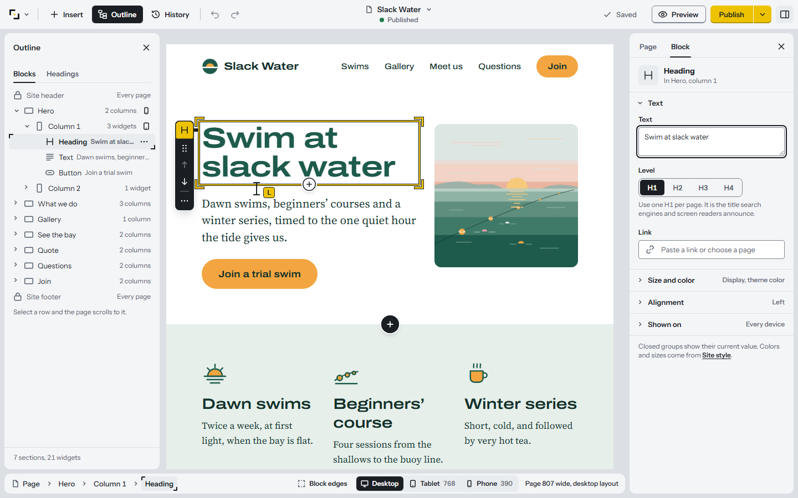

The editor with the home page open, its heading selected: the Outline on the
left, the page in the middle, the heading's settings on the right.

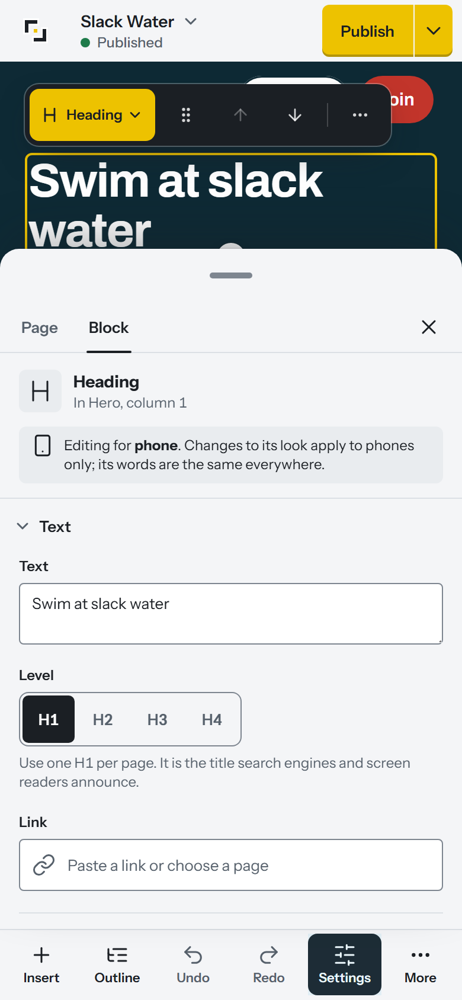

The same editor on a 390 by 844 phone, at twice the pixels: the heading
tapped, and its settings risen from the bar at the foot.

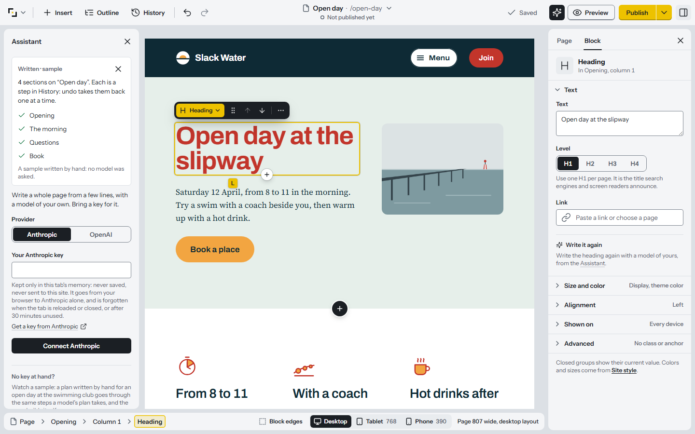

The Assistant after writing a page, the sample written by hand: each of its
four sections went onto the canvas as it came, and each is a step in
History. The page's heading is selected, with Write it again among its
settings.

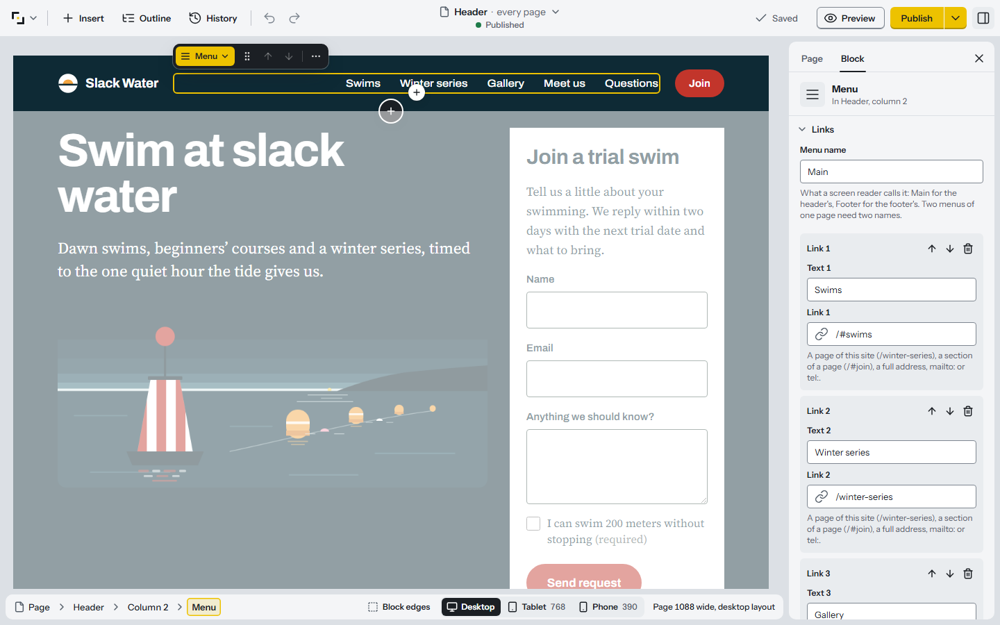

The site's header, opened by a click on it, built as a page is: its menu
selected, the menu's links on the right, the home page dimmed under it.

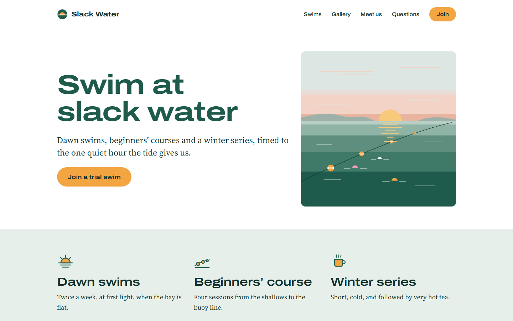

The same page as Rails serves it to a 1440 by 900 window.

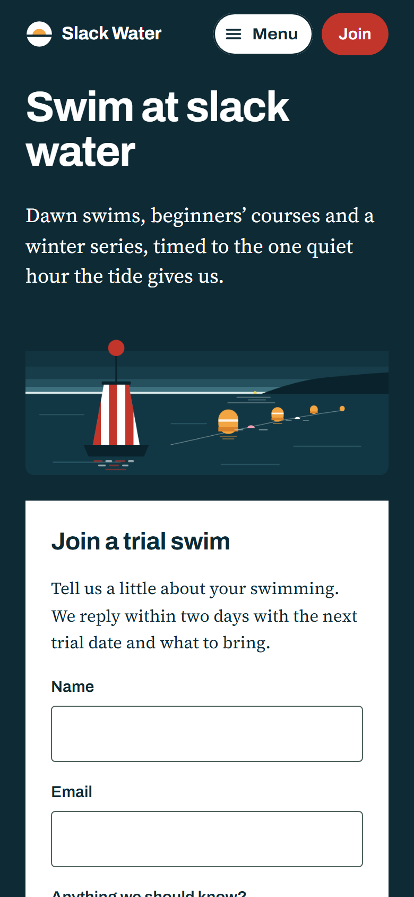

The same page on a 390 by 844 phone, at twice the pixels: what the CMS serves
with no script and the stylesheets it holds.

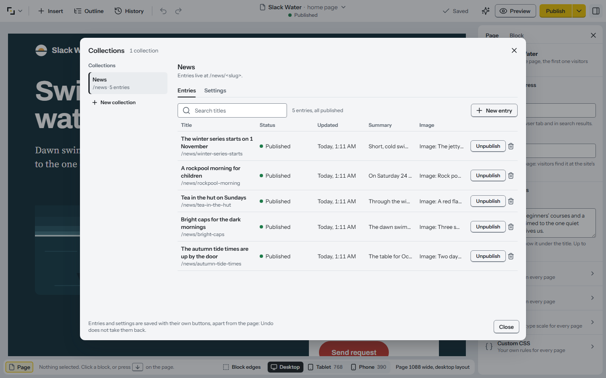

Collections, from the editor's menu: the example site's News, its five
entries each with its status, when it last changed and its first two
fields in words, newest first, the collection's own order.

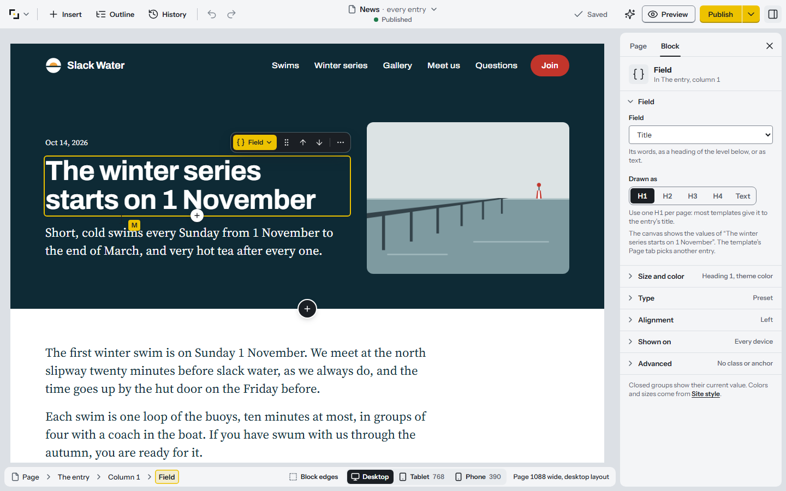

The template of News, opened from its settings and built as a page is,
drawn with the newest entry: its day, its title, its summary and its
picture are Field blocks, the title selected and its settings on the
right.

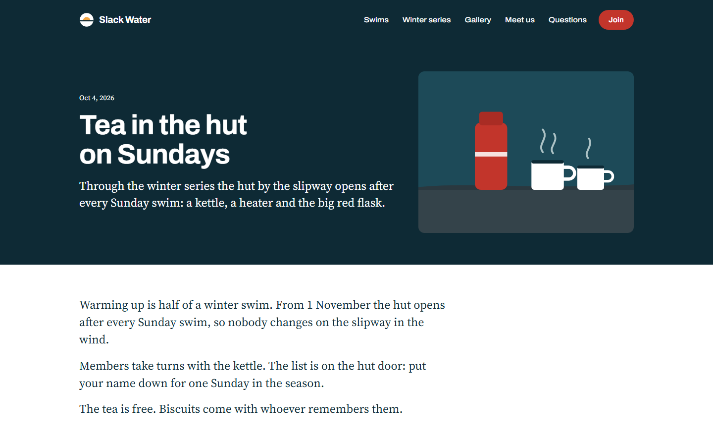

One of its entries as Rails serves it at `/news/tea-in-the-hut`, the
template's published version drawn with what the entry published.

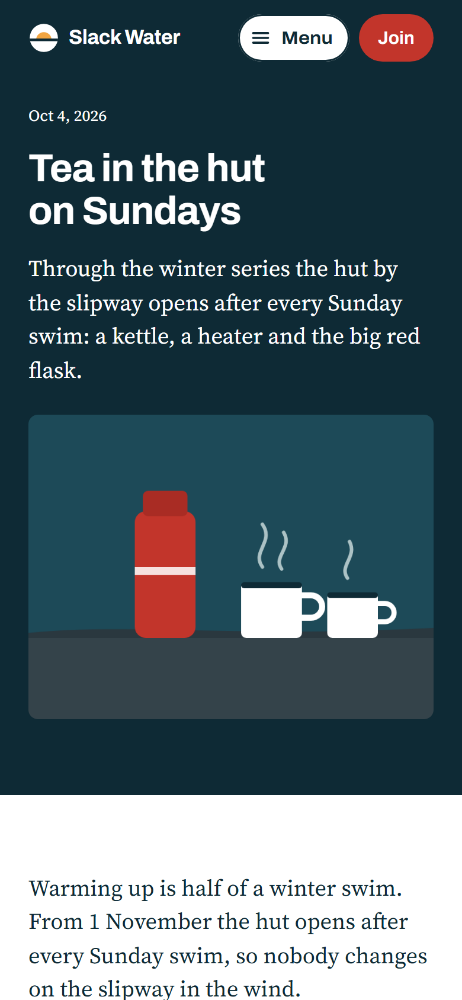

The same entry on a 390 by 844 phone, at twice the pixels.

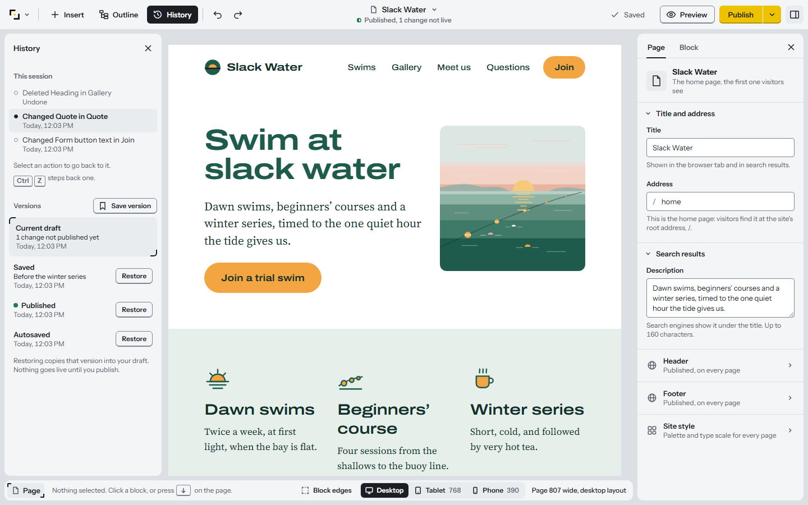

The History: this session's changes, a version kept under a name, the
version that is live, and the draft one change ahead of it.

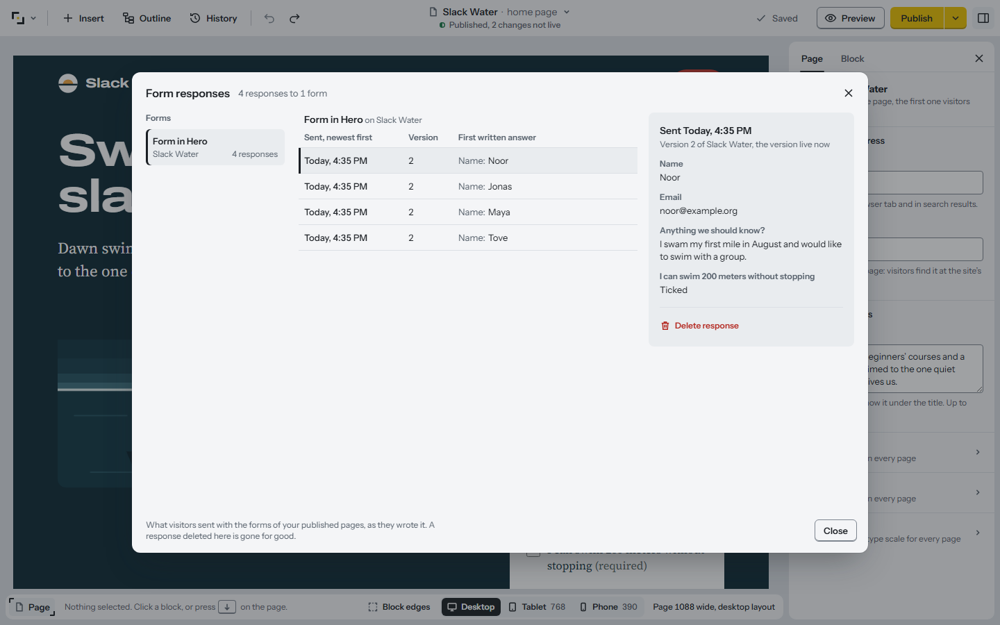

Form responses: what four visitors sent from the served home page, the
newest opened whole.

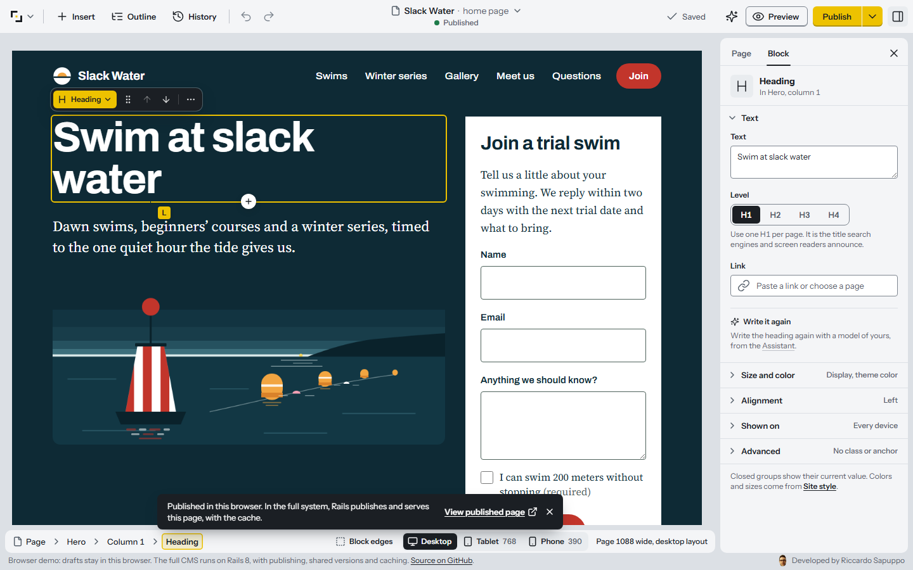

The browser demo after Publish: the editor with no server, its notice about
what the full system does, and its line at the bottom.

## Decisions

Each note says what was decided, what it costs, and the command that shows
it holds; [docs/decisions/](docs/decisions/) has them all.

- **The page document has one schema, and two validators are held to it.**
  The editor and the server read one file and agree on every document of a
  corpus of 284 files. Cost: every rule a schema cannot say is written
  twice, and only the corpus keeps the copies in step.
  [The note](docs/decisions/one-schema-two-validators.md).
- **A page is sections of one to four columns holding widgets, and nothing
  else.** Cost: some layouts cannot be made, and every page is three levels
  deep. [The note](docs/decisions/strict-hierarchy.md).
- **A page is drawn twice, by the server and by the editor, and both are
  held to the same output.** Cost: every widget is written twice, and a
  golden that changes is a page that changes.
  [The note](docs/decisions/pages-drawn-twice-one-contract.md).
- **A page has one draft, saved at a revision, and a version is made on
  purpose.** Cost: two tabs do not merge, one is chosen.
  [The note](docs/decisions/one-draft-saved-at-a-revision.md).
- **Every edit is a command with an exact inverse.** Cost: no free-form
  change; each new edit is written with its inverse and tried on random
  sessions. [The note](docs/decisions/every-edit-is-a-command.md).
- **Published pages are cached by key, and nothing is deleted to refresh
  them.** Cost: every visit is a request, if only a 304, and a change to
  the release redraws every page once.
  [The note](docs/decisions/published-pages-cached-by-key.md).
- **The header and footer are parts of the site: documents of blocks,
  edited and published as pages are.** A click on either around a page
  opens it in the editor, the page dimmed around it; it has a draft that
  saves itself, versions, a preview, a publish and a schedule, and every
  published page shows a publish at its next visit, its ETag and cached
  HTML keyed on the parts' published versions. Until a part publishes,
  every page draws its starter (`cms/config/parts`). The header may stay
  at the top of the window while the page scrolls (Sticky header, in its
  Page tab). Cost: a change is live only once published, and a part holds
  no form and no anchor. [The note](docs/decisions/header-and-footer-are-parts.md), which
  replaced [the header and footer kept as the site style is](docs/decisions/header-and-footer-kept-as-the-site-style.md).
- **Collections are typed entries: a definition held to a schema, values
  held to it by rules written twice, a template kept as a part.** A
  collection's fields are of nine types; an entry's values are checked
  against them by rules written in TypeScript and in Ruby, held to one
  verdict by a corpus of 124 cases; an entry has a draft saved at a
  revision and what is live, and the template its entries are drawn with
  is a page of kind `template`. A Collection list draws a collection's
  published entries on any page, Field blocks draw an entry's values in
  its template, and the CMS serves each entry at `/<prefix>/<slug>`,
  cached by keys that name the collection's changes. A page may live at
  the prefix, `/news` listing what `/news/<slug>` draws: a page's address
  is one part and an entry's two, so the two never meet (a rule that kept
  them apart went on 16 October 2026). Cost: another pair of twins to
  keep in step, a definition changed without a revision, a list of
  entries read whole, a page listing a collection drawn again at every
  publish of its entries, and the section's page kept at its prefix by
  hand. [The note](docs/decisions/collections-are-typed-entries.md).
- **A menu folds into Menu where the widths of its letters say.** A menu
  block folds on its own width, and a page runs no script, so the server
  adds up letter widths measured once in the site's typeface and names the
  step below which the links fold. Cost: a file to measure again when the
  menu's styles or the measuring machine's fonts change, a fold that may
  come a step early, and, where a visitor's font draws a letter wider than
  the file counted, links that wrap onto two lines inside their block.
  [The note](docs/decisions/header-folds-by-measured-letters.md).
- **The editor reaches storage through one interface, and one battery holds
  every adapter to it.** Cost: the browser's checks are a copy of Ruby's, and
  it runs 64 of the 71 cases.
  [The note](docs/decisions/storage-behind-an-adapter.md).
- **The browser demo is a build of its own, and draws what the CMS would
  serve.** Cost: two entry points to keep in step, and no demo online while
  the repository is private.
  [The note](docs/decisions/demo-without-the-cms.md).
- **The editor reaches the CMS's API through its development server's
  proxy.** Cost: the proxy exists only in development; a built editor needs
  one origin behind a reverse proxy, or CORS on the API.
  [The note](docs/decisions/editor-api-through-the-dev-proxy.md).
- **The editor opens the preview and the live page on the CMS's own origin.**
  Cost: a build is tied to one CMS address.
  [The note](docs/decisions/editor-links-to-the-cms-origin.md).
- **Pages, cache and jobs live in SQLite files, with no Redis, no Docker and
  no service.** Cost: one host, and no compression or TLS of its own.
  [The note](docs/decisions/sqlite-and-the-solid-trio.md).
- **The API has no authentication, so the servers listen on 127.0.0.1 and
  refuse to listen anywhere else.** Cost: a tool for one person on one
  machine. [The note](docs/decisions/no-authentication-one-address.md).
- **A visitor's form is counted under the socket's own address.** Cost: behind
  a proxy the whole site shares one count of ten forms in ten minutes.
  [The note](docs/decisions/form-count-by-socket-peer.md).
- **A visitor's model key stays in the tab's memory, and the page can send
  it only to its provider.** The browser calls Anthropic or OpenAI
  straight. The build's Content-Security-Policy lets the page connect to
  the site and the two APIs and nothing else. Cost: a reload forgets the
  key, and the development server has no policy.
  [The note](docs/decisions/assistant-key-in-memory.md).

What those decisions add up to for the person who extends the project is
[what adding a widget takes](#adding-a-widget): one commit, listed below.

## Adding a widget

What adding a widget takes is one commit, on both sides:
[`b664d0a`, "Add the form widget, the whole of what a new widget takes"](https://github.com/riccardosapuppo/page-builder-cms/commit/b664d0a95307c6692de58b1a9cbcbe51fd9b35a4).
The form was added alone in it, after the editor and the server were
built; what the server does with a sent form, and Form responses, came
after it in commits of their own. `git show --stat b664d0a` lists its 276
files: 225 are the schema's corpus written again, and the other 51 are
these places:

- the schema: the type, one branch of the block dispatch, the widget's
  props, and its valid and invalid cases for both validators;
- a rule the schema cannot say, in TypeScript and in its Ruby twin: a
  form's field names are unique in the form;
- the editor's types, the widget's words, what the Outline shows after
  its name, its sidebar groups, and the Forms group of Insert and of the
  picker;
- for a widget with a list of items, the name of an item and the order of
  an item's keys in the editor's commands;
- the widget's own folder: its definition, icon, React renderer, panel
  with its test and accessibility test, and a line in each registry;
- the browser: the widget's own test, and what the accessibility tree is
  asked in `e2e/widgets.spec.ts`, which runs every widget's cases;
- the server: the ERB partial, its type among a column's widgets, its
  look in `site.css`, and its view test;
- the render contract: a fixture of traps, with the goldens and the
  manifest written again;
- the random pages of the agreement and command checks, and the lists
  and counts that name every widget.

Two things no widget had needed before came with it, and are there for
the next one: a sidebar with more than one group of a widget's own, and
a safety check of the render contract that lets the form widget's own
form through. [`builder/src/widgets/README.md`](builder/src/widgets/README.md#adding-a-widget)
names each place by file, with the commands that check them.

[`tools/readme-widget.test.ts`](tools/readme-widget.test.ts) holds this
section to the repository, in `npm run test:tools`: the commit linked
exists in this history with the subject, the 276, 225 and 51 files given
here, and one new widget folder, which the registry lists; and every file
the widgets README names exists. A shallow clone fails it, so CI's tools
job checks out the whole history. A wrong count, a changed hash and a
renamed file each made it fail when planted.

## Measurements

Every number in this section was produced by the command given with it,
run from the repository's root on 8 October 2026 (the bundle's on
9 October, after the header and footer's panel), on one machine: a Windows
10 virtual machine with 8 logical processors (an Intel Core i7-10700 at
2.90 GHz) and 12 GB of memory, with Node 24.19.0, Ruby 3.4.11 (YJIT off),
Rails 8.1.4 on Puma 8.0.2 with its 3 threads, and headless Chromium
151.0.7922.34, the build Playwright 1.62.1 is held to.

The server's and the editor's measurements work on one page,
`contract/fixtures/large-500.json`: 500 blocks, 25 sections, 61 columns and
414 widgets of twelve of the twenty kinds (no stats, steps, pricing, form, logo, menu, collection list or field), which the
server renders to 211 KB of HTML. Its nine library images are the example
site's pictures, uploaded to the run's own library as the editor uploads an
image, with the library's ids in place of the fixture's own; the rest is the
fixture as it is. (Ten of its images name another site, which this machine
cannot fetch.) Each command that needs servers starts them, on ports of its
own (3902 for the production CMS, 3901 and 4901 for the e2e CMS and the
editor; `MEASURE_SERVER_PORT`, `MEASURE_CMS_PORT` and `MEASURE_EDITOR_PORT`
move them, and these runs used 3906 and 4906), with databases and an Active
Storage root of its own, and deletes them when it ends.

How a number is taken:
- **On a quiet machine.** A command waits until two readings in a row, three
  seconds each, have all the processors under 15% busy, and gives up (exit
  2) if the machine does not settle in fifteen minutes, rather than measure.
  Each run is taken after a quiet reading and read again after it; a run the
  machine was busy after is thrown away and taken again, and the text beside
  each table says how many were. The ranges of load below are those
  readings, before and after the runs kept. A virtual machine cannot see
  what its host is doing: the load is the guest's own, and it is read
  between the runs, not during them. `MEASURE_ALLOW_BUSY=1` measures anyway,
  and the output then says it was taken under load and is not to be quoted.
- **Several times.** A number is the median of many runs with the smallest
  and the largest beside it, not one run. A 95th percentile is given only
  where there are hundreds of values to take it from.
- **Against a baseline.** The server's health check, which draws nothing, and
  the same drag on a page of four blocks say what the stack and the harness
  cost by themselves.
- **Able to fail.** Each command also checks that it measured what it says:
  that every answer had the page's 500 blocks, that a cold visit wrote a row
  for the page, each of its blocks and each block of the header and footer
  around it, that the drag was engaged and saved nothing, that the editor's
  text chunk was not loaded to open the page. `npm run test:tools` runs the
  tests of the tools themselves, among them one that reads this section and
  fails if a command in it does not exist. The measurements are not part of
  `npm run check`, which does not wait for a quiet machine: those tests are.

### A published page, on the server

`npm run measure:server`, on 8 October 2026 from 16:33 to 16:37 UTC, the
machine 4% then 1% busy before it, no run thrown away (its output ended
`RESULT: 29 checks passed`). The CMS in production mode, Solid Cache on its
own SQLite database, one visit at a time over one connection:

| One visit | The application (X-Runtime), ms | The client, to the last byte, ms | Runs | Load before and after the runs |
| --- | --- | --- | --- | --- |
| The health check, `/up`: no database, no view | 1.10 (0.66 to 3.45) | 16.3 (13.8 to 31.3) | 100 | 2 to 3% |
| Drawn with no cache (the draft preview) | 106 (91.9 to 174) | 122 (101 to 192) | 30 | 3 to 6% |
| Cold: Solid Cache emptied, on the server that is running | 387 (317 to 495) | 413 (339 to 522) | 15 | 1 to 9% |
| The first visit after a start: a new server, Solid Cache empty | 611 (501 to 710) | 632 (530 to 728) | 8 | 1 to 6% |
| Warm: the whole page read from Solid Cache | 3.99 (3.18 to 5.78) | 16.8 (8.54 to 30.1) | 100 | 2 to 3% |
| A 304: the ETag sent back | 2.87 (2.41 to 6.10) | 16.2 (10.8 to 31.6) | 100 | 2 to 6% |
| One heading changed and published | 21.8 (17.0 to 33.3) | 38.7 (23.0 to 46.6) | 15 | 1 to 13% |
| The site style changed | 17.8 (14.4 to 26.8) | 32.0 (26.4 to 45.8) | 15 | 0 to 14% |

Median, and the smallest to the largest run in brackets. What each visit
read from Solid Cache and wrote to it, counted as the store receives the
calls (`tools/lib/count-reuse.rb`, in production, on the same databases, one
visit each):

| Visit | Reads | Fragments asked for | Found | Writes | Fragments written |
| --- | --- | --- | --- | --- | --- |
| Cold | 88 | 501 | 0 | 88 | 501 |
| Warm | 1 | 1 | 1 | 0 | 0 |
| A 304 | 0 | 0 | 0 | 0 | 0 |
| One heading changed | 4 | 37 | 33 | 4 | 4 |
| The site style changed | 2 | 26 | 25 | 1 | 1 |

These numbers are from before the header and footer became parts of the
site. A run of 12 October 2026 with them (from 14:04 UTC, the machine 2%
then 3% busy, no run thrown away, `RESULT: 30 checks passed`) found every
median inside the range given above for its row: cold 391 ms, the first
visit after a start 569, warm 5.01, a 304 2.95. What changed is what is
cached: a page also draws the header's and footer's 12 blocks around its
own, each a fragment, so a cold visit asks for and writes 513 fragments in
97 reads and 97 writes, and one heading changed asks for 39 and finds 35.

A run of 15 October 2026 (from 22:58 UTC, the machine 1% then 1% busy, no
run thrown away, `RESULT: 38 checks passed`) measured the collections'
pages too. An entry's page, its collection's template the same 500 blocks
with the entry's title and summary drawn in two of them: cold 425 ms
(389 to 498), warm 6.61 (5.48 to 11.5), and the first visit to another
entry 29.3 (23.6 to 48.5), which draws only its two fields, their column,
their section and its page, 5 fragments, and reads the rest back. A page
holding a Collection list of twelve entries, after one of them is renamed
and published: 15.8 ms (11.3 to 36.4), the list, its column, its section
and the page drawn again, 4 fragments.

- **A cold visit is slower than no cache.** It draws the same 500 blocks as
  the preview does, and also makes the 501 keys, asks for them in 88 reads
  that find nothing, and writes them in 88 writes: 387 ms against 106. That
  row empties Solid Cache from outside, on a server that has already
  answered hundreds of requests: it is what a visit costs after the cache is
  emptied, not what the first visit after a deploy costs.
- **The first visit after a start is dearer still.** A deploy is a new
  process, whose templates are not yet compiled and whose code has not yet
  run, and whose cache finds nothing: 611 ms (501 to 710), 224 more than the
  cold visit on a running server. Each of its 8 runs stops the server,
  empties Solid Cache, starts the server again, waits for `/up` and a second
  more, and visits once, so every run is on a server of its own
  (`MEASURE_RUNS_START` sets the number). The visits after it cost what the
  rows above and below say.
- **A warm visit is one read.** 3.99 ms in the application, 2.87 for a 304
  that reads nothing: a difference of 1.1 ms, and 211 KB more on the wire.
  The client cannot tell either from the health check (16.3 ms), which does
  no work at all: 16.8 and 16.2 ms. On this stack that 16 ms belongs to the
  stack (Puma, the loopback of Windows, Node's client; which of them is not
  looked into here), not to the page. The application's own column is the
  one to read for the small ones.
- **One block changed: 497 of 500 are not drawn again.** Of the 37 fragments
  asked for, 33 were found; the 4 written are the heading, its column, its
  section and the page. 21.8 ms against 387 cold and 106 with no cache. A new
  site style writes only the page's own fragment and finds the other 25 in
  the cache: 17.8 ms.
- **No compression.** The CMS sends the HTML as it renders it, 211 KB; a proxy
  in front would compress it, and none was in the way here.

### The editor, in the browser

`npm run measure:builder`, on 8 October 2026 from 16:37 to 17:04 UTC, the
machine 4% then 5% busy before it (its output ended `RESULT: 19 checks
passed`). Headless Chromium 151.0.7922.34 at 1440 by 900, against the e2e
CMS, in two forms of the editor: the production build served by `vite
preview`, and the development server `npm start` runs. Nine runs of each,
every run in a browser context of its own with nothing cached. No run of
the production build was thrown away; five of the development server's were,
because the machine was 17 to 25% busy after them, and were taken again.

Opening the page of 500 blocks, in ms from the start of the navigation:

| Form | The page's data arrived | The 500 blocks are in the canvas | The frame after them is made | Of that, after the data | Long tasks of the main thread | Load |
| --- | --- | --- | --- | --- | --- | --- |
| Production build | 252 (235 to 6,854) | 1,041 (966 to 7,693) | 1,190 (1,105 to 7,855) | 934 (865 to 1,001) | 3 (3 to 5), 935 (841 to 1,078) ms | 1 to 11% |
| Development server | 645 (600 to 714) | 2,231 (2,098 to 2,315) | 2,424 (2,311 to 2,511) | 1,764 (1,645 to 1,833) | 5 (5 to 5), 1,875 (1,730 to 1,964) ms | 2 to 15% |

One of the nine openings of the production build, the first, took 7.7 s, its
data arriving after 6.9 s, and the median of the nine is 1,041 ms. Its cause
is not known; the same thing happened to one opening on 4 October.
`MEASURE_DRAG=0 MEASURE_FORMS=build MEASURE_RUNS_BUILDER=40 npm run
measure:builder`, run the same day (17:04 to 17:08 UTC), opened the page 40
more times: the blocks were in the canvas after 1,049 ms (954 to 1,204), the
data after 246 (228 to 279), the frame after them 1,192 (1,099 to 1,339), the
load 0 to 12% (seven runs were thrown away and taken again, the machine
being 15 to 80% busy after them), and none stalled.

Where the main thread's time went, from the creation of the page to the
frame after its blocks, by the browser's own counters (median, ms): the
production build was busy 1,142, of which 592 in JavaScript, 375 in layout
(79 layouts) and 34 in style recalculation; the development server 2,099, of
which 1,489 in JavaScript and 361 in layout. The page has 3,001 DOM nodes and
the JavaScript heap is 57.5 MB.

Dragging a block across the page: the block is held by its grip while the
page is scrolled to 14 positions spread evenly over its 65,268 px, and the
pointer goes down the canvas and up again at each, 482 moves in all. The
frame interval is the time between two animation frames; the pointer's
latency is from the move to the end of the second frame after it (the editor
answers a move in a task after the frame it arrived in, and the second frame
is the one that draws the answer, so a page that does nothing about a move
reads about 30 ms). The 4-block page is the baseline.

| Form | Page | Frame interval, median / 95th / worst, ms | Frames over 33 ms | Pointer latency, median / 95th / worst, ms | Long tasks (over 50 ms) | Runs | Load |
| --- | --- | --- | --- | --- | --- | --- | --- |
| Production build | 500 blocks | 16.7 / 50.1 / 250 | 244 of 2,376 | 62.4 / 189 / 373 | 89, 6,114 ms | 9 | 1 to 11% |
| Production build | 4 blocks | 16.7 / 16.7 / 16.8 | 0 of 526 | 30.1 / 34.5 / 61.0 | 0 | 9 | 1 to 11% |
| Development server | 500 blocks | 16.7 / 66.7 / 617 | 335 of 2,390 | 81.8 / 212 / 761 | 198, 13,949 ms | 9 | 2 to 15% |
| Development server | 4 blocks | 16.7 / 16.8 / 50.0 | 2 of 579 | 29.2 / 45.4 / 90.8 | 1, 50 ms | 9 | 2 to 13% |

Medians over the runs of each run's own median, 95th percentile and worst;
the 95th percentiles of all the runs' frames pooled are 50.1 ms and 66.7 ms
(21,359 and 21,475 frames) and of their pointer moves 190 and 212 ms (4,338
moves each). In each run the live region named 82 to 88 different places the
block would go to, and nothing was saved: the page sent no write to the CMS.

In the production build the 482 moves took 52.3 s on the 500-block page, 9.2
moves a second, and 8.8 s on the 4-block page, 55 a second. The main thread
was busy 47.7 s of the 52.3 (91%), 27.6 s of that in JavaScript, 1.7 in style
recalculation and 0.3 in layout; on the 4-block page, 1.5 s. That is 99 ms of
main thread for a pointer move, against 3.2.

These numbers are from before the header and footer became parts of the
site, which the canvas now draws, locked, around the page. A run of 12
October 2026 with them (14:07 to 14:33 UTC, `RESULT: 19 checks passed`,
two runs of the development server thrown away, the machine 47% and 16%
busy after them, and taken again) opened the page in the production build
in 1,077 ms (993 to 1,183), its data after 291, with 3,034 DOM nodes; the
drag across it had a pointer latency of 61.7 ms at the median and 190 at
the 95th percentile.

**These numbers are bad and are left as they are.** The 500-block page takes
about 1.2 s to open, 0.9 s of it after its data has arrived, and a drag
across it takes the pointer's moves at about nine a second, with a latency of
62 ms at the median and 189 at the 95th percentile where the baseline gives
30 and 34. The development server is worse on both. `MEASURE_PROFILE=only npm
run measure:builder` (17:08 to 17:10 UTC) profiles one run on an unminified
build and says where the JavaScript's time went. A profiler slows the page,
so only the shares are to be read:
- **Opening:** 20.9% of the sampled time is in the canvas's `measure`, which
  reads the page's width in a layout effect, and 23.4% in an anonymous
  function right after it in the same module, which the profile does not name
  and I take to be the canvas's next layout effect, the one that queries the
  new elements. They are the first code to need the new DOM laid out, so the
  browser's own style and layout of its 3,001 elements is paid there, as the
  counters above say (375 ms of layout). React's render of the 500 blocks is
  15.2%, and inserting the elements 7.8%.
- **Dragging:** 43.5% of the sampled time is in `overDrawer`
  (`builder/src/editor/drag/dnd.ts`), which each of the 500 blocks, as a drop
  target, runs at every pointer move to ask whether the pointer is over a
  drawer, and which looks the drawers up with
  `document.querySelectorAll(".drawer")` every time. 35.5% is the drag
  library's position observer measuring the targets again (`updateShape`),
  and 14% React rendering what changed; the shares of a function and of what
  it called overlap. Looking the drawers up once per move, not once per block,
  would take the first of these away. These measurements describe the editor
  and did not change it, so it is left as it is.

### The bundle

`npm run measure:bundle`, on 10 October 2026 at 06:09 UTC (its output ended
`RESULT: 9 checks passed`). It builds the editor twice, as `npm run
builder:build` does, into folders of its own: the two builds are the same
files, byte for byte. This is the editor that talks to the CMS; the demo's
build is another one ([The two modes](#the-two-modes)). Gzip is level 9. The
sizes do not depend on the load of the machine.

| File | What | Raw | Gzipped |
| --- | --- | --- | --- |
| `index-*.js` | The main chunk, loaded at once: React, the drag library, the schema's validator, the widgets, the header's letter widths, the editor | 942,258 B (920.2 KiB) | 252,675 B (246.8 KiB) |
| `index-*.css` | The stylesheet, loaded at once | 107,600 B (105.1 KiB) | 19,490 B (19.0 KiB) |
| `index.html` | The page | 1,423 B | 756 B |
| | Loaded at once, in all | 1,051,281 B (1026.6 KiB) | 272,921 B (266.5 KiB) |
| `TextEditor-*.js` | The text editor (TipTap, ProseMirror), loaded when a text is first edited | 358,570 B (350.2 KiB) | 113,514 B (110.9 KiB) |
| `activestorage.esm-*.js` | The upload code, loaded at the first upload | 15,268 B (14.9 KiB) | 5,026 B (4.9 KiB) |
| 4 `.woff2` files | The fonts, fetched when a page uses them | 399,984 B (390.6 KiB) | no smaller: they are compressed already |

On 4 October, before the form widget and Form responses, the main chunk was
842,681 B (226,273 gzipped); on 8 October, before the header and footer's
panel and the letter widths the canvas folds its menu by, 889,647 B
(236,091 gzipped); on 9 October, before those letter widths held what
the fallback fonts draw the letters of Greek, Cyrillic, Hebrew, Arabic and
CJK at, 929,971 B (247,707 gzipped); on 10 October, before an Arabic
letter counted the widest of its joined forms and the file kept a
fingerprint of the fonts, 941,490 B (252,257 gzipped); later that day,
before a Greek, Cyrillic or Hebrew letter counted the most it adds after
another and the file kept a second fingerprint, 941,849 B (252,474
gzipped).

What is lazy is read from the files: `index.html` names only the entry, the
entry reaches the text editor and the upload code with `import()` and never
statically, and a string only ProseMirror holds is in the text editor's
chunk and not in the entry. Opening the 500-block page did not request the
text editor's chunk in any run above.

### What these numbers do not say

- Chromium here paints in software and has no screen: the compositor of a
  real display is not in them, and the frame intervals are those of a 60 Hz
  timer. Only Chromium was measured, only on Windows, and only one visit at
  a time: the CMS was not measured under concurrent visits.
- The load is read between runs, on the guest. A stall that shows as no
  load is not explained by it.
- The client's times for small answers are the 16 ms floor of this stack.
  The application's column shows them, and it is the application's own time,
  from where Rails starts its clock to its response, not Puma's.

## The two modes

The editor is one program with two storages behind it, and the project is
shown in both.

**The full system** is what the rest of this README describes: Rails and the
editor, started together by `npm start`. Rails keeps the pages in SQLite,
versions them, publishes them now or at a set time, serves them at their own
addresses from a cache, takes the answers visitors send from a form, and
runs its jobs in Solid Queue. The editor is its client, through the API in
[`cms/openapi.yaml`](cms/openapi.yaml).

**The browser demo** is the same editor with the browser's storage in
place of Rails: [Try the editor in your browser](https://builder.riccardosapuppo.com/).
On a first visit it puts in the example site, four pages, the collection
News with its five entries and its template, and fifteen pictures,
as the CMS's seed does from the same files, and everything after is kept in
that browser's IndexedDB, held to the same battery of cases as the CMS's
adapter. A visitor back after the demo is built with a newer example site
is given it at once if nothing was changed in that browser; one who changed
something keeps it, and the demo's line offers to start over with the new
one. Two tabs of one browser share the pages, and the one that saves
second gets the conflict bar. Preview opens the draft as it would be
published, and Publish opens the page as published, each drawn by the demo,
with a line saying what the full system does in its place; a Collection
list's card, and an entry's View in Collections, open the entry as
published there, drawn with its collection's template. The header and
footer are built and published there as on the CMS, and every page
published in that browser shows them. A form there is
not sent: one line says what Rails does with its answers. At the bottom, one
line: "Browser demo: drafts stay in this browser. The full CMS runs on Rails
8, with publishing, shared versions and caching. Source on GitHub.", and
at its end "Developed by Riccardo Sapuppo" beside the author's face, a link
to the author's site. Its key shuts the line down to that credit and opens
it again, and the browser remembers the choice.

**The demo's limits**, which are those of having no server:
- **Nothing is served.** No page at an address of its own, no cache, no
  scheduled publishing, no job, no form answers and no Form responses. What
  is not there has no control: the editor draws none.
- **Drafts stay in one browser.** Another browser, or another person, sees
  none of them; clearing the site's data deletes them. A browser that
  refuses IndexedDB (some private windows), one with no room left, or a tab
  holding an older version of the storage says so, on screen, instead of
  starting or saving.
- **Images are resized in the browser** to 2400 pixels on the long side, and
  no smaller copies are kept, as for the CMS.
- **Publish is a version and a state**, not a publication: the page it opens
  is the demo's drawing of the document, not HTML a server wrote.
- **It is online on a host of its own, with a mirror on GitHub Pages.** At
  `https://builder.riccardosapuppo.com/` is a build of `main` made for the
  root of a host (`DEMO_BASE=/`, [builder/README.md](builder/README.md)),
  uploaded from this machine. The CI's `demo` job builds and tries the demo
  on every run, and its `pages` job deploys it to GitHub Pages from `main`,
  at `https://riccardosapuppo.github.io/page-builder-cms/`, a mirror every
  push brings up to date, while the repository is public: the free plan
  publishes Pages from public repositories alone. Every page of the demo
  asks search engines to leave it out of their indexes. From a clone,
  `npm run build:demo --prefix builder` then `npm run serve:demo --prefix
  builder` serve the same build as Pages serves it, and `npm run e2e:demo
  --prefix builder` tells its story in Chromium. On GitHub Pages the page
  is cached ten minutes by headers a site cannot set, so for that long
  after a new deploy a browser may load the previous page.

[builder/README.md](builder/README.md#the-browser-demo) has how it is built,
served and held to what it promises, and the
[note](docs/decisions/demo-without-the-cms.md) why it is a build of its own.

## What it does not do

Each of these is a choice, and the reason is given with it.

- **No sign-in, users, roles or permissions.** They would double the
  project and open every question of who may see and change what. So the API
  has no authentication, and the servers listen on 127.0.0.1 only
  ([the decision](docs/decisions/no-authentication-one-address.md)).
- **No themes to swap, and the site's own CSS stays inside the site.** A
  page's look is values from the design's tokens (a palette, a type scale
  and a letter width, set once in Site style). A colour of the site's own,
  `#rrggbb`, is one such value: a palette slot or a block may name one,
  and the page draws it from a stylesheet the CMS writes for the colours
  it names (`/colors/<digest>.css`), never from an inline style. So is
  a heading's, a text's or a quote's own type (`/type/<digest>.css`): a
  size in px, rem or vw, a vw drawn as a hundredth of the page's own
  width so the canvas shows it as the page does, a weight, letter
  spacing, a line height and a letter width, each within the ranges the
  schema and its rules hold
  ([the decision](docs/decisions/free-type-by-attribute.md)). What the
  tokens leave out, the site's custom CSS gives (the owner's decision, 14
  October 2026): one stylesheet, written in the editor beside Site style,
  drawn on every page after the theme's inside an `@scope (.site)` rule
  (`/custom.css`). It reaches a block by the CSS classes and the anchor
  the block's Advanced group gives it. It is checked to keep to the site
  (no rule left open, no brace that closes nothing, no `@import`), the
  theme's own class names are refused to a block, and on the canvas its
  rules stop at the editor's controls. A block's other settings stay
  tokens.
- **No plugins, no translation of the interface, no live co-editing.** The
  interface is in one language, en-US. Two tabs get a conflict to settle, not
  a merge ([the decision](docs/decisions/one-draft-saved-at-a-revision.md)).
- **No second back end.** The editor has one API. The demo's storage is the
  same editor's other adapter, held to the same battery, not another server.
- **No uploaded SVG.** An image is a JPEG, a PNG, a GIF or a WebP, recognised
  by its bytes, not by its name.
- **No smaller copies of an image.** The CMS has no image library (no
  libvips): the editor resizes each image in the browser, to 2400 pixels on
  the long side, before it goes up.
- **No mixed containers**: no widget straight in a section, no column in a
  column ([the decision](docs/decisions/strict-hierarchy.md)).
- **No pages of entries.** A Collection list shows at most 24 entries, in
  an order and through a filter on a choice or a toggle field; there is
  no second page and no archive by month. An entry has a draft and what
  is live, no versions
  ([the decision](docs/decisions/collections-are-typed-entries.md)).
- **No Redis, no Docker, no mail.** SQLite files, Rails' own cache and queue,
  and answers that are kept and read in the editor, never sent by email.
- **No TLS and no compression of its own.** Production forces SSL and assumes
  a proxy in front that ends it, and that would compress the page.
- **Not measured**: concurrent visits, any browser but Chromium, any system
  but Windows; and nothing has run on macOS.

## Checking it

`npm run check` runs every check of the repository, one after another, and
reads each one's counts from what the tool's own reporter wrote, never from
an exit code alone: Vitest's and Playwright's JSON, minitest's summary, the
TAP of Node's test runner, the summary lines of the other tools. A suite
fails when anything in it failed, when its count is zero, or when it is under
the floor written for it. A suite that cannot run here is listed at the end
as not run, and the run exits 2, never 0. `npm run check -- --list` names the
suites; `--only` and `--skip` take those names. [tools/README.md](tools/README.md#npm-run-check)
says how a floor works and how the Vitest suites hold on a busy machine.

On 13 October 2026, on the virtual machine of [Measurements](#measurements),
with the run's servers on their own ports (3900 and 4900 for `npm
start`'s checks, 3901 and 3902 for the CMS, 4901 and 4902 for the
editor, 4903 for the demo), one run of the whole check, ending at 17:14
UTC, spent 38 minutes in its suites. It ended `RESULT: 7 of 28 failed`.
Most of that had not followed the evening's change to the example site's
header and footer, whose menus now lead to its other pages: a test of the
tools, a unit test, two Rails tests, the demo's test of the header, the
production check, whose new header still had the old four links, and in
Chromium a test of the video window, whose room on the screen came from
how far the page scrolls, and so from the footer's height. A new test
had a lint error, which also failed the unit test that runs the lint.
And two tests of form responses met the machine's network changing under
them (`net::ERR_NETWORK_CHANGED`). Corrected, each passed in a later run:
the failed suites again, ending at 17:26 UTC, and the Chromium tests that
had failed, alone. bundler-audit was not run here, for want of its
advisory database (CI runs it). Its counts:

| Suite | What it counted |
| --- | --- |
| the repository's tools, type-checked | 0 type errors |
| the tools' own tests | 125 passed, 1 skipped (it needs process groups, and runs in CI) |
| the editor, type-checked and linted | 3 programs, 0 type errors; Oxlint, 460 files, 0 warnings |
| the editor's unit tests, and the render contract's editor half | 969 passed in 122 files, the count of the later run; 28 passed |
| the editor's build and its bundle check | passes: no `eval`, no `Function`, the validator and four fonts with their licences in, the CMS's storage in and the browser's out |
| the schema's two validators | 284 corpus files, and the example site's 3 pages with the 2 starters of the header and footer, 0 disagreements, 0 exceptions; the corpus is what its generator writes; the lint caught 19 of 19 planted faults |
| the 500-block fixture, the example site's pictures and the header's letter widths | each is what its generator writes |
| the API description | valid, 0 warnings |
| the Rails tests | 412 runs, 2592 assertions, 0 failures, 0 errors, 0 skips; 374 API answers held to `cms/openapi.yaml` |
| RuboCop, Brakeman | 160 files, no offenses; 79 checks, 0 warnings |
| the editor against a CMS of its own | 86 tests: the storage battery, the random-page agreement check, canvas parity, the header and footer and the menu's fold against the CMS's, and the API examples of `cms/README.md` run as written (85 where Windows PowerShell is not) |
| the editor in Chromium against a CMS of its own | 234: 231 passed in that run, among them the three that failed on this machine before (below), and the other three in the later run alone |
| the editor on the browser's own storage | 79 passed, 7 skipped (the four of scheduling and the three of responses, which need a server) |
| the browser demo, as Pages serves it | 10 passed, in the later run |
| accessibility: the keyboard path, focus, axe | 50 passed |
| how the shell, the demo and the pages are served | 84 checks, the demo at both of its bases, what a shared link to it previews with among them |
| the CMS in production, over HTTP and in a browser | 63 checks, in the later run |
| `npm start` in smoke mode, and its stops | 7 checks; 11 checks |

**The three that failed** on 8 October, at 1024 by 768, were about text, and
the cause is found: how this machine's Windows session draws it. Two tests
of `e2e/editor.spec.ts` expected a text block's name, "Text", drawn above
its block, and one of `e2e/drop-window.spec.ts` expected a video window to
grow by 40 pixels (it grew by 36.27). Both asked a question that the width
of a few letters decides. With the session drawing text smoothed (ClearType),
Chromium places the letters at fractions of a pixel: "Text" then ends 0.27
pixel inside the canvas's edge and stands beside its block, where the room
for it is 43.5 pixels (19 of the canvas's margin and 24.5 of the page's
padding at that scale) and the name with its gap takes 43.2; and the room
over the video window is 36.27 pixels, not 40. The editor screenshot of
5 October, when they passed, has unsmoothed text (two colours in each
region of text, against 390 today), which Chromium places at whole pixels,
and no launch flag of Chromium pins the width. They passed on that commit in
CI on Linux, and nothing in stage 6 changed them. The system setting was not
toggled to confirm it.

They no longer depend on it. The tablet step asks for a side only of the
names that are several pixels from the edge (a heading's is 22 past it, an
accordion's 33), holds "Text" to the rule itself (a name stands beside its
block when, put there, it ends inside the canvas, and above it when it would
not), and the resize test brings "Text" above its block at 840 wide, where it
is 5 pixels short, not at 1024; the video window is grown by less than the
room it measures over the line. Nothing they check was loosened: each of the
three still fails when the behaviour it covers is broken.

The steps of the CI file's browser job took, on this machine in that run,
55.2, 842.1, 56.9, 318.9 and 28.1 seconds: the tests against a CMS of
their own, the browser tests, the browser storage's tests, the
accessibility tests again and the serving checks, 21.7 minutes in all
(20.5 on 8 October, before the header and footer's tests).

## What is in the repository

| Folder | What it holds |
| --- | --- |
| [`cms/`](cms/README.md) | The Rails 8.1 application: pages, one draft each and their versions; publishing, now or at a set time; the media library, the site style and the header and footer; collections, their entries and their templates; the JSON API of [`openapi.yaml`](cms/openapi.yaml); the published pages and entries, drawn on the server in the design's theme and cached, with a draft preview and a 404 page; the jobs; the forms visitors send and their answers. Its README has the commands to install, run and test it, and how the caches and the jobs work. |
| [`builder/`](builder/README.md) | The editor: React 19, TypeScript and Vite, every dependency pinned. The document and its commands, the store with undo and redo, the two storage adapters, the renderer, the widgets, the interface, and the browser demo's shell. Its README has the commands, the stages' account and what each check holds. |
| [`schema/`](schema/README.md) | The page document's one schema and a collection's, the design tokens the code reads, the corpora both validators are held to and the tools that compare them, and the icon box's icons. |
| [`contract/`](contract/README.md) | The render contract: documents and the HTML the server renders for each, which the editor's renderer is held to. |
| [`example-site/`](example-site/README.md) | Slack Water, an invented swimming club: four page documents, the collection News with its five entries and its template, and fifteen pictures drawn from SVGs, the one copy that `ruby bin/rails db:seed` and the browser demo load. |
| [`design/`](design/) | The approved design, in static HTML: the editor and a published page, the tokens, the mark, the fonts with their licences, and screenshots of every state. [`design/layout/`](design/layout/) is the editor's layout, approved on 3 October 2026, drawn the same way. |
| [`docs/`](docs/decisions/) | [The decisions](docs/decisions/), each with its cost and the command that shows it holds, and [the pictures](docs/images/README.md) this README shows. |
| [`tools/`](tools/README.md) | The repository's own Node tools: `npm start`, `npm run check`, the measurements, the pictures, and their tests. |
| [`.github/workflows/ci.yml`](.github/workflows/ci.yml) | The checks on Linux, and on Windows where the code takes another path there, each job with a time limit. |

It was built in stages, from 1 October 2026: the design, approved before any
code was written; the Rails side, with the schema and the API; the editor;
editing in depth (rich text, undo and redo, versions, a tablet's and a
phone's own values, the keyboard, the media library) and then the approved
layout; publishing and performance (caching, scheduled publishing, jobs, the
measurements above); forms; and last the browser demo, the pictures and
this README.

## License

MIT, see [LICENSE](LICENSE). Developed by Riccardo Sapuppo. The fonts in
`design/fonts/` are under the SIL Open Font License, with each licence file
next to its font. The editor's icons are Lucide's, under the ISC License:
the files it draws them from are in `builder/src/editor/lucide/`, with the
licence beside them, and it is quoted in `builder/src/editor/icons.tsx`.
